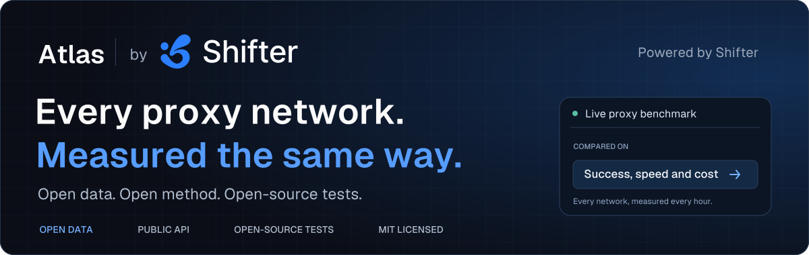

<p align="center">
  <a href="https://shifter.io/atlas?utm_source=github&amp;utm_medium=referral&amp;utm_campaign=atlas&amp;utm_content=readme_header">
    
  </a>
</p>

<h1 align="center">Atlas: Open Proxy Benchmarks</h1>

<p align="center">
  Every proxy network. One method. Measured around the clock.<br>
  <strong>Open data. Open method. Open-source test framework.</strong>
</p>

<p align="center">
  <a href="https://shifter.io/atlas?utm_source=github&amp;utm_medium=referral&amp;utm_campaign=atlas&amp;utm_content=readme_nav_atlas">Atlas Rankings</a> ·
  <a href="https://shifter.io/atlas/methodology?utm_source=github&amp;utm_medium=referral&amp;utm_campaign=atlas&amp;utm_content=readme_nav_method">Methodology</a> ·
  <a href="#public-api-quickstart">Public API</a> ·
  <a href="https://shifter.io/atlas/compare?utm_source=github&amp;utm_medium=referral&amp;utm_campaign=atlas&amp;utm_content=readme_nav_compare">Compare Networks</a> ·
  <a href="https://shifter.io/?utm_source=github&amp;utm_medium=referral&amp;utm_campaign=atlas&amp;utm_content=readme_nav_shifter">Shifter</a>
</p>

**Atlas** is an open benchmark of residential proxy networks, maintained by [Shifter](https://shifter.io/?utm_source=github&utm_medium=referral&utm_campaign=atlas&utm_content=readme_intro). It sends the same requests through every network it measures, to the same types of sites, around the clock, and publishes what it finds: success on real sites, speed, availability, IP pool size and spread, how independent each pool is, and what a successful request really costs. See the results at [shifter.io/atlas](https://shifter.io/atlas?utm_source=github&utm_medium=referral&utm_campaign=atlas&utm_content=readme_intro_site).

This repository contains everything behind those results: the Python test framework and CLI that runs the measurements, the scoring that turns them into rankings, and the Go API that serves the published data. Anyone can read how a number was produced, and run the same tests on their own proxies.

```sh
curl https://atlas.shifter.io/v1/rankings?range=24h
```

## Contents

- [Why Atlas?](#why-atlas)
- [What Atlas measures](#what-atlas-measures)
- [How scoring works](#how-scoring-works)
- [Public API quickstart](#public-api-quickstart)
- [Run the tests yourself](#run-the-tests-yourself)
- [Repository layout](#repository-layout)
- [About Shifter and its products](#about-shifter-and-its-products)
- [Development](#development)
- [FAQ](#faq)
- [Contributing and support](#contributing-and-support)
- [License](#license)

## Why Atlas?

Every proxy provider advertises millions of IPs and near-perfect success. Buyers rarely get a way to check those claims before they pay, and comparison sites often rank providers by commission instead of by measurement.

Atlas answers the questions that decide a purchase with measured data: which sites a network gets through on, how fast and steady it is, how large and independent its pool really is, and what a successful request costs once failures are counted. Every network goes through the same requests, checks and published scoring, including Shifter's own network.

| Capability | What it helps you do |
| --- | --- |
| **Same test for every network** | Compare providers on identical requests, sites and schedules. |
| **Real-site success** | See which networks get the real page on search engines, online stores, social networks, bot-protected sites and AI assistants. |
| **Measured pool size** | Count the IPs a network actually hands out, not the number on its website. |
| **Pool independence** | See how much of a pool appears on no other network, so two providers do not share the same exits. |
| **True cost per success** | Compare what 1,000 successful requests cost, with failed requests counted in. |
| **Hourly, daily and monthly views** | Follow every figure over the last 24 hours, 7 days or 30 days. |
| **Public API** | Read every published figure as JSON. |
| **Open method** | Read the exact formulas and run the same tests on your own proxies. |

## What Atlas measures

| Measurement | How it is measured |
| --- | --- |
| **Pulse** | A short test of 100 requests through each network in each country, repeated around the clock, on plain HTTP and HTTPS pages. |
| **Daily test** | A larger test per country once a day, which also counts the distinct exit IPs. |
| **Browser targets** | Real pages loaded in a browser through each network: search, online stores, social networks, sites behind bot challenges and AI assistants. A request only counts when the real page comes back. |
| **Census** | Counts the exit IPs a network hands out, and where they are: countries, cities and internet providers. |
| **Overlap** | Finds IPs that appear on more than one network, to show how independent a pool is. |
| **Pricing** | Each network's published plans, to compute the cost of a successful request. |

## How scoring works

Each network gets an **Atlas Score** from 0 to 100, built from eight parts: reliability, speed, availability, coverage, pool diversity, hosting-network share, authenticity and value. Each part compares the network with the best measured network on that part. The exact weights and formulas are in [`formulas/`](formulas/) and on the [methodology page](https://shifter.io/atlas/methodology?utm_source=github&utm_medium=referral&utm_campaign=atlas&utm_content=readme_method), and each published result names the methodology version it was scored with.

## Public API quickstart

The published data is free to read as JSON. Every endpoint takes `range=24h`, `7d` or `30d`.

```sh
# The ranking of every measured network
curl --fail https://atlas.shifter.io/v1/rankings?range=30d

# The home view: market figures and every network's headline numbers
curl --fail https://atlas.shifter.io/v1/home?range=24h

# One network's measurements, and its charts
curl --fail https://atlas.shifter.io/v1/networks/shifter
curl --fail https://atlas.shifter.io/v1/networks/shifter/chart?range=7d

# Results by site type, the latest events, the changelog and the code words
curl --fail https://atlas.shifter.io/v1/targets?range=30d
curl --fail https://atlas.shifter.io/v1/events
curl --fail https://atlas.shifter.io/v1/changelog
curl --fail https://atlas.shifter.io/v1/codes
```

The full endpoint reference and field documentation are in [`api/README.md`](api/README.md).

## Run the tests yourself

The test framework is a standalone Python 3.12+ library and CLI. A single run needs no database or scheduler.

```sh
uv sync --locked --no-editable
uv run --no-editable atlas targets

# Set PROXY_URL privately in your environment first.
uv run --no-editable atlas run --target generic_http --requests 5000 --concurrency 100
uv run --no-editable atlas enrich results/RUN_ID
```

Every supported provider has a run config in [`configs/`](configs/) and a credential grammar in [`src/atlas/providers/grammars/`](src/atlas/providers/grammars/). Copy `credentials.toml.example` to `.secrets/credentials.toml` and fill in your own account; the private copy is excluded from Git. The [provider guide](docs/providers.html) lists the shared parameters (`country`, `region`, `city`, `zip`, `asn`, `session`, `ttl`).

IP enrichment uses a locally supplied DB-IP database file, which is not included in this repository; see the [DB-IP website](https://db-ip.com/) for its license.

## Repository layout

| Path | Contents |
| --- | --- |
| [`src/atlas/`](src/atlas/) | The Python test framework, CLI, provider adapters and scoring. |
| [`api/`](api/) | The Go API that serves the published results. |
| [`formulas/`](formulas/) | The scoring formulas, one file per figure. |
| [`configs/`](configs/) | Public run configs per provider, and the methodology. |
| [`docs/`](docs/) | The standalone guide: setup, measurement definitions and result contracts. |
| [`tests/`](tests/) | The Python test suite. |

## About Shifter and its products

[Shifter](https://shifter.io/?utm_source=github&utm_medium=referral&utm_campaign=atlas&utm_content=readme_about_shifter) provides proxy infrastructure and web data APIs for developers and businesses. Atlas is run by Shifter, and Shifter's own network goes through exactly the same tests and scoring as every other network; the [disclosure page](https://shifter.io/atlas/disclosure?utm_source=github&utm_medium=referral&utm_campaign=atlas&utm_content=readme_disclosure) explains how that separation works.

| Product | What it offers | Useful for |
| --- | --- | --- |
| [**Residential Proxies**](https://shifter.io/services/residential-proxies?utm_source=github&utm_medium=referral&utm_campaign=atlas&utm_content=readme_residential_proxies) | Rotating residential IPs with country, city and ISP targeting. | Web scraping, SEO monitoring and regional data collection. |
| [**ISP Proxies**](https://shifter.io/services/isp-proxies?utm_source=github&utm_medium=referral&utm_campaign=atlas&utm_content=readme_isp_proxies) | Static residential addresses that keep their IP. | Long sessions and account workflows. |
| [**Web Scraping API**](https://shifter.io/services/scraping-api?utm_source=github&utm_medium=referral&utm_campaign=atlas&utm_content=readme_scraping_api) | Managed retrieval of website content, with proxies and blocks handled. | Applications that need web data without running the fetching stack. |
| [**SERP API**](https://shifter.io/services/serp-api?utm_source=github&utm_medium=referral&utm_campaign=atlas&utm_content=readme_serp_api) | Search engine results as structured data. | Rank tracking, keyword research and search data. |

[Explore Shifter](https://shifter.io/?utm_source=github&utm_medium=referral&utm_campaign=atlas&utm_content=readme_shifter_cta) · [View pricing](https://shifter.io/pricing?utm_source=github&utm_medium=referral&utm_campaign=atlas&utm_content=readme_pricing) · [Free IP lookup](https://ip-info.com/?utm_source=github&utm_medium=referral&utm_campaign=atlas&utm_content=readme_ip_lookup)

## Development

Requirements: Python 3.12 or newer with [uv](https://docs.astral.sh/uv/), and Go 1.27 or newer for the API.

```sh
# Python framework
uv sync --locked
uv run pytest

# Go API
cd api
go test ./...
```

See [`docs/index.html`](docs/index.html) for the full developer guide, the result contracts and the PostgreSQL schema used for history.

## FAQ

### Is Atlas independent if Shifter runs it?
Shifter runs Atlas and is measured with exactly the same requests, checks and published scoring as every other network. The method and the code are public in this repository, so anyone can check that no network is treated differently. Shifter's weak results are published as plainly as its strong ones.

### How often is the data updated?
Pulse tests run around the clock and the rankings are recalculated every hour. Daily tests and browser targets run on a daily cycle.

### Can a provider pay for a better position?
No. There is no paid placement. Every position comes from the published measurements and formulas.

### Can I test my own proxies with Atlas?
Yes. Install the framework, add your provider's credentials to a private file and run the same tests Atlas uses. See [Run the tests yourself](#run-the-tests-yourself).

### Why does Atlas count fewer IPs than a provider advertises?
Providers count every address seen over a long period. Atlas counts the distinct addresses the network actually hands out during the measurement window.

### Can I use the published data?
Yes. The API is free to read. Please credit "Atlas by Shifter" with a link to [shifter.io/atlas](https://shifter.io/atlas?utm_source=github&utm_medium=referral&utm_campaign=atlas&utm_content=readme_faq_credit) when you publish it.

## Contributing and support

Bug reports and pull requests are welcome. See [CONTRIBUTING.md](CONTRIBUTING.md). To report a security issue, use GitHub's private vulnerability reporting on this repository (see [SECURITY.md](SECURITY.md)) rather than a public issue.

Questions about Shifter's products: [contact Shifter](https://shifter.io/contact?utm_source=github&utm_medium=referral&utm_campaign=atlas&utm_content=readme_contact).

## License

Atlas is released under the [MIT License](LICENSE). Copyright (c) 2026 Shifter.

The DB-IP database used for IP enrichment is not included and has its own license.
